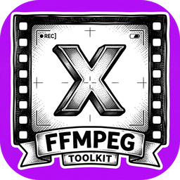
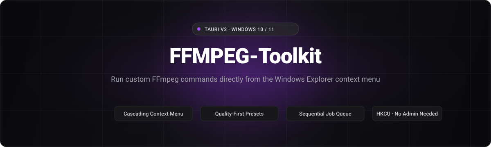
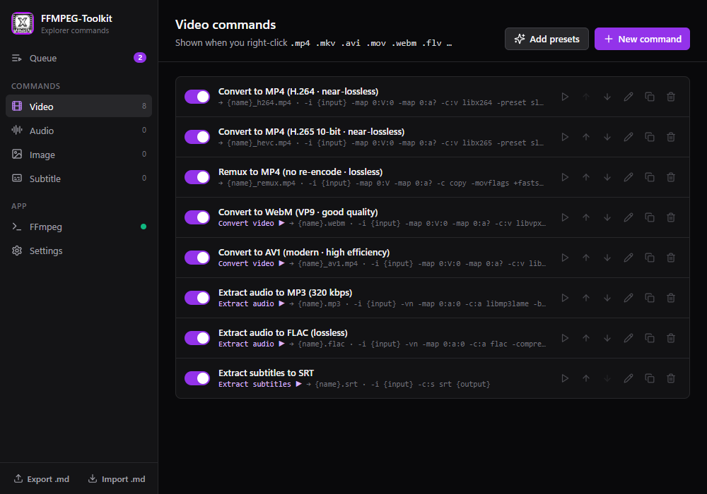
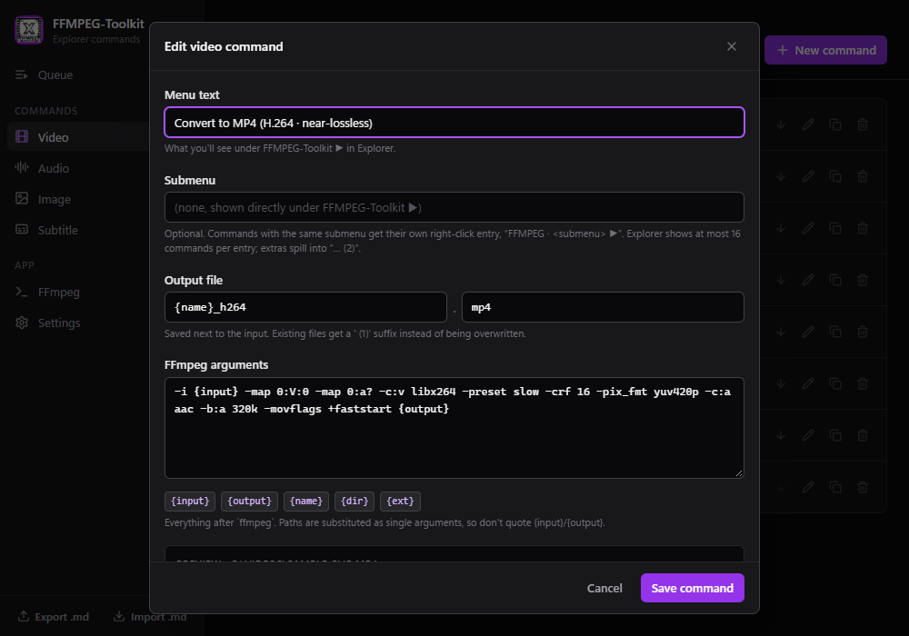
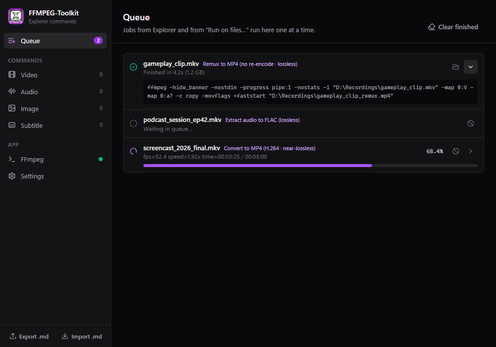
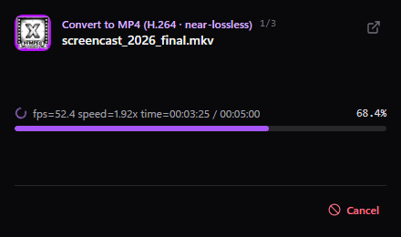
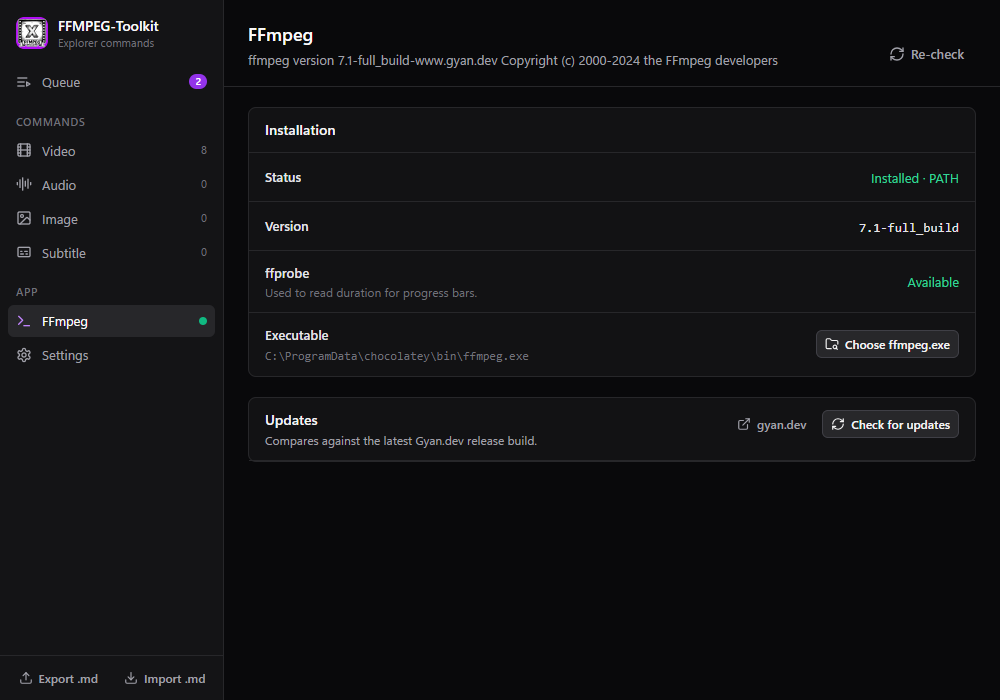
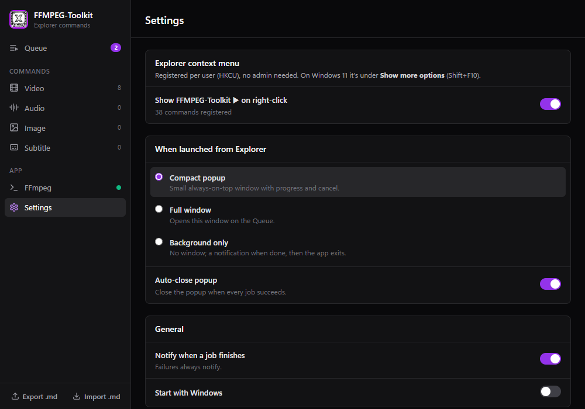
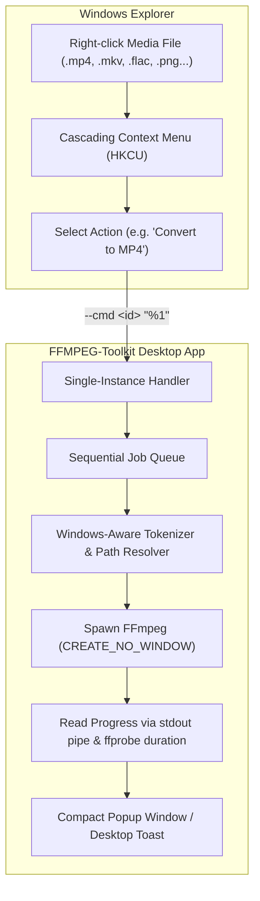

<p align="center">
  
</p>

<h1 align="center">FFMPEG-Toolkit</h1>

<p align="center">
  <strong>Define custom FFmpeg commands per file type and execute them directly from the Windows Explorer context menu.</strong>
</p>

<p align="center">
  
  
  
  
</p>

<p align="center">
  
</p>

<p align="center">
  <a href="#about">About</a> •
  <a href="#features">Features</a> •
  <a href="#screenshots">Screenshots</a> •
  <a href="#how-it-works">How It Works</a> •
  <a href="#installation">Installation</a> •
  <a href="#usage">Usage</a> •
  <a href="#building-from-source">Building from Source</a> •
  <a href="#windows-registry-integration">Windows Registry Integration</a> •
  <a href="#license">License</a>
</p>

---

## About

**FFMPEG-Toolkit** is a lightweight Windows 10/11 desktop utility built with **Tauri v2** (Rust backend, React 18 + TypeScript + Vite + Tailwind CSS frontend). It integrates directly with the Windows shell by registering custom, user-defined FFmpeg actions into the Windows Explorer cascading right-click menu under `HKEY_CURRENT_USER`—requiring no administrative privileges.

Whenever you select one or more media files in Explorer and trigger a command, jobs are dispatched to a centralized, sequential processing queue with real-time percentage progress, speed telemetry, and non-destructive output handling.

---

## Features

- **Cascading Context Menu per File Category**: Define actions tailored specifically to **Video**, **Audio**, **Image**, or **Subtitle** files. Commands register automatically against relevant extensions and Windows perceived types.
- **Sequential Job Queue**: Selecting multiple files feeds into a single queue managed via `tauri-plugin-single-instance`, preventing multiple FFmpeg processes from saturating your CPU and GPU.
- **Accurate Live Progress**: Computes real-time progress percentages by parsing `-progress pipe:1` microseconds against `ffprobe` container durations.
- **Safe Windows-Aware Argument Tokenizer**: Tokenizes arguments before substituting `{input}`, `{output}`, `{name}`, `{dir}`, and `{ext}` placeholders, ensuring paths containing spaces never require fragile manual escaping.
- **Non-Destructive Output Naming**: Target files automatically append ` (1)`, ` (2)` increments if a file with the destination name already exists.
- **Multiple Explorer Launch Modes**: Configure how jobs appear when invoked from Explorer: a compact always-on-top progress popup, full window view, or background processing with Windows desktop toast notifications.
- **Human-Readable Markdown Sync**: Export your entire command configuration into structured Markdown files, and import them back using duplicate-aware merge or full replacement.
- **Built-in FFmpeg Detection & WinGet Updater**: Validates local `ffmpeg` and `ffprobe` binaries, checks for Gyan.dev release updates, and installs or upgrades FFmpeg directly via WinGet with live console streaming.

---

## Screenshots

<p align="center">
  
  <br /><em>Main Window: Manage commands per category with active toggles, submenu grouping, and one-click execution.</em>
</p>

<p align="center">
  
  <br /><em>Command Editor: Live command-line preview, placeholder guide, and collision-proof output templates.</em>
</p>

<p align="center">
  
  <br /><em>Sequential Job Queue: Real-time encoding progress, speed metrics, output folder access, and task cancellation.</em>
</p>

<p align="center">
  
  <br /><em>Compact Popup: Minimalist always-on-top progress monitor for fast right-click jobs.</em>
</p>

<p align="center">
  
  <br /><em>FFmpeg Management: Environment detection, binary validation, and integrated WinGet updater.</em>
</p>

<p align="center">
  
  <br /><em>Settings: Configure Explorer context menu sync, launch modes, and finish notifications.</em>
</p>

---

## How It Works



1. **Trigger**: Windows Explorer invokes the registered binary with `--cmd <command-id> "%1"`.
2. **Forwarding**: If an instance is already active, `tauri-plugin-single-instance` forwards the CLI arguments to the running process without opening extra window shells.
3. **Queueing**: The file is queued as an immutable job snapshot.
4. **Execution**: The Rust worker executes jobs sequentially, prepending `-hide_banner -nostdin -progress pipe:1 -nostats` and spawning `ffmpeg.exe` directly (never through a shell) with `CREATE_NO_WINDOW`.
5. **Feedback**: Progress telemetry is broadcast across active frontend windows, updating the UI or notifying the user upon completion.

---

## Installation

### Prerequisites

- **Operating System**: Windows 10 or Windows 11 (64-bit)
- **WebView2**: Microsoft Edge WebView2 Runtime (pre-installed on modern Windows)
- **FFmpeg**: An accessible `ffmpeg.exe` and `ffprobe.exe` binary on your system `PATH` (or configured via in-app settings / installed automatically via the in-app WinGet updater)

### Getting Started

1. Download the latest release installer (`.exe` or `.msi`) from the [Releases](https://github.com/projectGloria/FFMPEG-Toolkit/releases) page.
2. Run the installer and launch **FFMPEG-Toolkit**.
3. On first run, default presets for Video, Audio, Image, and Subtitle conversion are populated automatically.
4. Verify your FFmpeg installation in the **FFmpeg** tab. If not found, click **Install with WinGet** to automatically set up the Gyan.dev FFmpeg build.
5. In **Settings**, ensure **Show FFMPEG-Toolkit on right-click** is enabled.

---

## Usage

### 1. Running Commands from Explorer

Right-click any supported media file in Windows Explorer, navigate to **FFMPEG-Toolkit ▶**, and select your desired action.

> **Windows 11 Note**: On Windows 11, classic cascading shell verbs are located under **Show more options** (`Shift + F10`).

### 2. Creating Custom Commands

Navigate to any category tab (**Video**, **Audio**, **Image**, or **Subtitle**) and click **New command**.

#### Available Placeholders

| Placeholder | Description |
| :--- | :--- |
| `{input}` | The absolute path to the selected source file. |
| `{output}` | The resolved destination path (`<dir>\<output_name>.<output_ext>`). Automatically increments `(1)`, `(2)` if the file exists. |
| `{name}` | Source filename without file extension. |
| `{dir}` | Folder path containing the source file. |
| `{ext}` | Source file extension (without leading dot). |

#### Example Command: Web-Optimized H.264 MP4

- **Label**: `Convert to Web MP4 (H.264 · 720p)`
- **Output Name**: `{name}_720p`
- **Output Ext**: `mp4`
- **Arguments**:
  ```text
  -i {input} -map 0:V:0 -map 0:a? -c:v libx264 -preset slow -crf 20 -vf "scale=-2:720" -c:a aac -b:a 192k -movflags +faststart {output}
  ```

### 3. Testing Commands in the App

You can test any command directly inside the application without navigating through Explorer:
1. Click the **▶ (Run on files...)** button on any command card.
2. Select one or more test files in the file picker.
3. The jobs will immediately queue and process in the **Queue** tab.

### 4. Backing Up & Sharing via Markdown

Use the **Export .md** button in the sidebar footer to export your entire configuration to a readable markdown file:

```markdown
# FFMPEG-Toolkit Commands

## Video

### Convert to MP4 (H.264 · near-lossless)
- Output: `{name}_h264.mp4`
- Submenu:
- Args: `-i {input} -map 0:V:0 -map 0:a? -c:v libx264 -preset slow -crf 16 -pix_fmt yuv420p -c:a aac -b:a 320k -movflags +faststart {output}`
```

To restore or import commands, click **Import .md** and choose between **Merge** (skips duplicates by label) or **Replace all**.

---

## Building from Source

### Prerequisites

- [Node.js](https://nodejs.org/) (v18 or higher) & `npm`
- [Rust](https://www.rust-lang.org/tools/install) stable toolchain with MSVC support (`x86_64-pc-windows-msvc`)
- Visual Studio C++ Build Tools

### Build Instructions

1. **Clone the repository**:
   ```powershell
   git clone https://github.com/projectGloria/FFMPEG-Toolkit.git
   cd FFMPEG-Toolkit
   ```

2. **Install frontend dependencies**:
   ```powershell
   npm install
   ```

3. **Run in development mode** (launches Vite dev server with hot module reload + Tauri Rust application):
   ```powershell
   npm run tauri dev
   ```

4. **Execute unit tests**:
   ```powershell
   # Runs tokenizer, placeholder resolution, and Markdown round-trip tests
   cargo test --manifest-path src-tauri/Cargo.toml
   ```

5. **Compile release installers**:
   ```powershell
   npm run tauri build
   ```
   Built binaries and installation packages (`.exe`, `.msi`) are generated in:
   ```text
   src-tauri/target/release/bundle/
   ```

---

## Windows Registry Integration

All right-click shell verbs are registered strictly under `HKEY_CURRENT_USER`:

```text
HKCU\Software\Classes\SystemFileAssociations\<target>\shell\FFMPEGToolkit
  ├─ MUIVerb     = "FFMPEG-Toolkit"
  ├─ SubCommands = ""
  ├─ Icon        = "\"C:\path\to\ffmpeg-toolkit.exe\",0"
  ├─ ExePath     = "C:\path\to\ffmpeg-toolkit.exe"
  └─ shell
       ├─ 00_<id8>   MUIVerb = "<Command Label>"
       │    └─ command (Default) = "\"C:\path\to\ffmpeg-toolkit.exe\" --cmd <command-id> \"%1\""
       └─ 01_<id8>   ...
```

- **Zero Elevation**: Runs and registers without Administrator privileges or UAC popups.
- **Self-Healing Sync**: The registry tree is synchronized whenever commands are modified, and verified on application startup to handle executable path changes.
- **16-Verb Limit Management**: Windows Explorer limits cascading menus to a maximum of 16 static verbs. FFMPEG-Toolkit maps command submenus (`group`) to distinct top-level roots (`FFMPEG · <Submenu> ▶`) and automatically partitions oversized sets across indexed roots (`... (2)`).

---

## License

This project currently has no declared open-source license. All rights are reserved by the original authors. Please consult the repository owners at [projectGloria/FFMPEG-Toolkit](https://github.com/projectGloria/FFMPEG-Toolkit) for permission or commercial usage inquiries.

---

## Acknowledgements

- [FFmpeg](https://ffmpeg.org/) — The universal multimedia framework.
- [Gyan.dev](https://www.gyan.dev/ffmpeg/builds/) — Windows FFmpeg build provider.
- [Tauri](https://tauri.app/) — Lightweight, memory-efficient desktop framework.
- [Lucide Icons](https://lucide.dev/) — Clean, consistent iconography.
